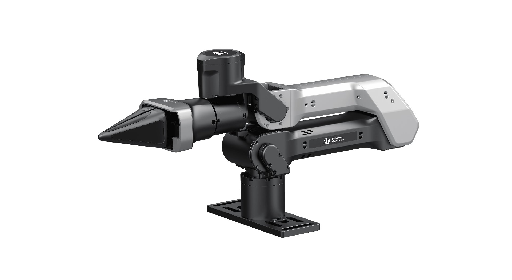

Founded in September 2023, Galaxea is a cutting-edge AI technology company specializing developing of Embodied AI foundation models and embodied AI robots. Anchored in its “Hardware + Intelligence” strategy and driven by an open, collaborative philosophy, Galaxea is dedicated to partnering with global leaders in Embodied AI to build and continuously empower a thriving ecosystem, bringing embodied AI technologies seamlessly into real-world applications and everyday life.

[English](README.md) | [简体中文](README_zh.md)

### 🤖 Galaxea A1Z

The Galaxea A1Z is an advanced robotic arm that combines high precision and intelligence. Designed to meet the needs of diverse industrial and innovative applications, it features flexible operation modes, strong payload capacity, and high programming compatibility. It is suitable for a wide range of scenarios, including precision assembly in industrial settings, automated operations in research labs, and innovative hands-on education.

| Repository                                                                | Purpose                                                                          |
|:------------------------------------------------------------------------- |:-------------------------------------------------------------------------------- |
| [galaxea_a1z](https://github.com/userguide-galaxea/galaxea_a1z)           | A1Z robotic-arm control SDK                                                      |
| [a1z-t](https://github.com/userguide-galaxea/a1z-t)                       | Production-model leader-follower teleoperation device for Galaxea A1Z arms       |
| [a1z-data-collect](https://github.com/userguide-galaxea/a1z-data-collect) | Teleoperation data collection scripts and tools                                  |
| [a1z-g05-deploy](https://github.com/userguide-galaxea/a1z-g05-deploy)     | Model training and deployment on the G05 framework                               |
| [a1z-pi05-deploy](https://github.com/userguide-galaxea/a1z-pi05-deploy)   | Model training and deployment based on π0.5                                      |
| [a1z-lerobot](https://github.com/userguide-galaxea/a1z-lerobot)           | Model training and deployment with the LeRobot framework                         |
| [OpenA1Z-T](https://github.com/userguide-galaxea/OpenA1Z-T)               | Open-source 3D-printed leader-follower teleoperation device for Galaxea A1Z arms |

### 🧩 Galaxea LEMO

LEMO is an all-in-one dual-arm development platform designed by Galaxea for general-purpose dual-arm manipulation and a wide range of real-world applications. Combining bimanual manipulation, visual perception, data collection, teleoperation, and open development capabilities, LEMO features two high-performance A1Z robotic arms, G1Z grippers, a multi-view vision system, and a CCU controller. It supports precision manipulation at individual workstations, task expansion across multiple workstations, and cross-scenario application development — bridging robotics research, task validation, and real-world productivity.

| Repository                                                        | Purpose                                                                                                                          |
|:----------------------------------------------------------------- |:-------------------------------------------------------------------------------------------------------------------------------- |
| [galaxea_lemo](https://github.com/userguide-galaxea/galaxea_lemo) | ROS 2 workspace for the LEMO platform: dual-arm teleoperation, camera capture, data recording, and inference service integration |

### 📐 Robot Models and CAD Files

| Repository                                        | Purpose                |
|:------------------------------------------------- |:---------------------- |
| [robot_descriptions](https://github.com/userguide-galaxea/robot_descriptions) | Robot description files |
| [STP](https://github.com/userguide-galaxea/STP)   | Robot STP CAD files    |
| [USD](https://github.com/userguide-galaxea/USD)   | Robot USD files        |
