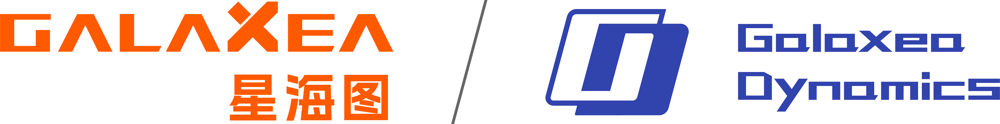
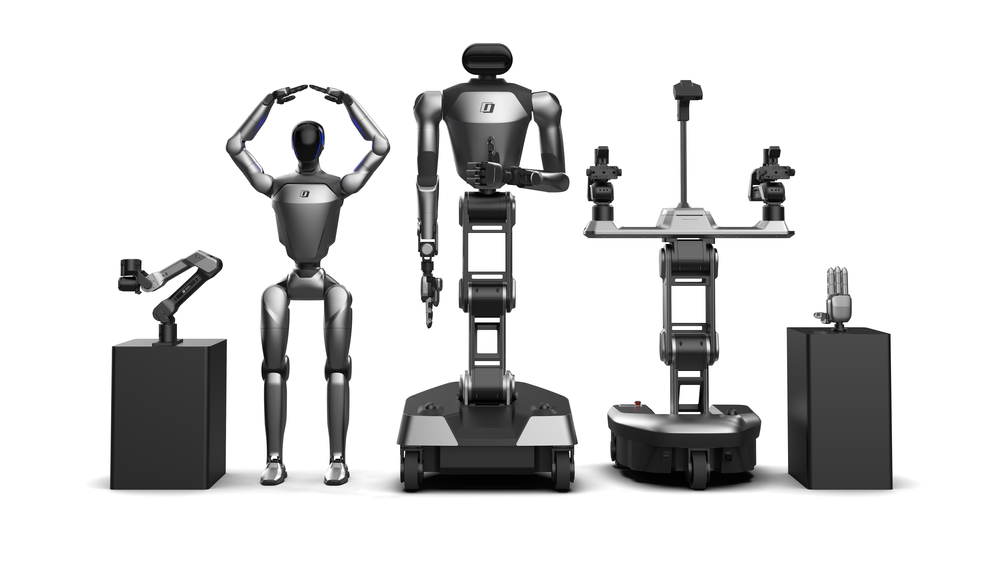
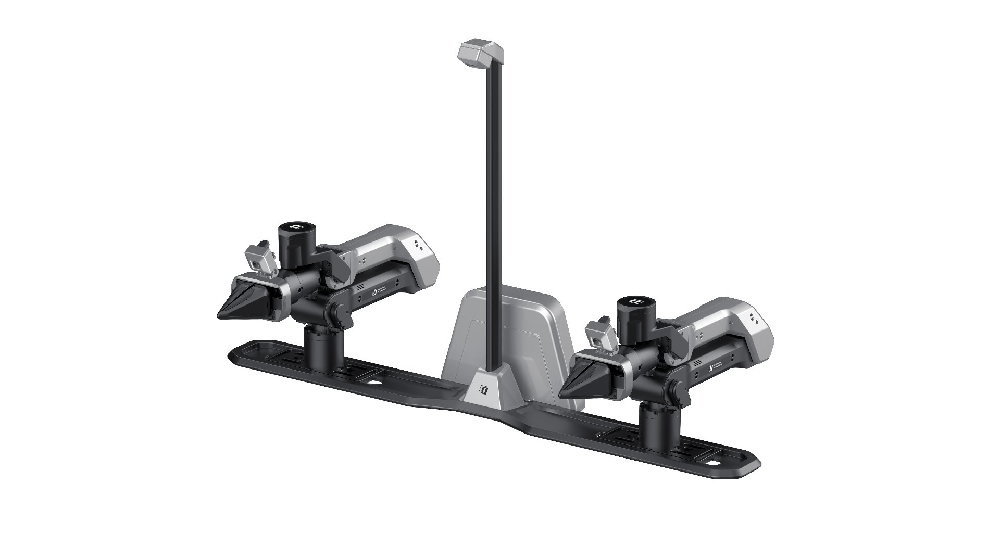

Founded in September 2023, Galaxea is a cutting-edge AI technology company specializing developing of Embodied AI foundation models and embodied AI robots. Anchored in its “Hardware + Intelligence” strategy and driven by an open, collaborative philosophy, Galaxea is dedicated to partnering with global leaders in Embodied AI to build and continuously empower a thriving ecosystem, bringing embodied AI technologies seamlessly into real-world applications and everyday life.

### 🤖 Galaxea A1Z

A1Z: Your First Desktop Smart Assistant – Ready to Use Out of the Box, Customizable for Any Scenario

| 仓库 | 用途 |
|:-----|:-----|
| [galaxea_a1z](https://github.com/userguide-galaxea/galaxea_a1z) | A1Z 机器人控制 SDK |
| [a1z-t](https://github.com/userguide-galaxea/a1z-t) | 产品版适配星海图 A1Z 机械臂的主从臂遥操作设备 |
| [a1z-data-collect](https://github.com/userguide-galaxea/a1z-data-collect) | 遥操作数据采集脚本与工具 |
| [a1z-g05-deploy](https://github.com/userguide-galaxea/a1z-g05-deploy) | 基于 G05 框架的模型训练与部署 |
| [a1z-pi05-deploy](https://github.com/userguide-galaxea/a1z-pi05-deploy) | 基于 π0.5 的模型训练与部署 |
| [a1z-lerobot](https://github.com/userguide-galaxea/a1z-lerobot) | 基于 LeRobot 框架的模型训练与部署 |
| [OpenA1Z-T](https://github.com/userguide-galaxea/OpenA1Z-T) | 开源 3D 打印版星海图 A1Z 机械臂的主从臂遥操作设备 |

### 🧩 Galaxea LEMO

LEMO 是面向具身智能开发者的双臂桌面操作平台，集遥操作、数据采集、模型部署验证与二次开发于一体，覆盖从数据采集、模型训练到推理部署的具身智能开发全流程。平台集成双 A1Z 机械臂、G1Z 夹爪、多视角同步视觉系统及 LEMO-CCU 控制盒，支持开箱即用、快速拆装、随放随用，可支撑高校、科研机构及机器人开发团队高效开展双臂操作研究与具身应用开发。

| 仓库 | 用途 |
|:-----|:-----|
| [galaxea_lemo](https://github.com/userguide-galaxea/galaxea_lemo) | LEMO 平台的 ROS 2 工作空间：双臂遥操作、相机采集、数据记录与推理服务接入 |

### 📐 机器人模型与数模文件

| 仓库 | 用途 |
|:-----|:-----|
| [URDF](https://github.com/userguide-galaxea/URDF) | 机器人 URDF 模型文件 |
| [STP](https://github.com/userguide-galaxea/STP) | 机器人 STP 数模文件 |
| [USD](https://github.com/userguide-galaxea/USD) | 机器人 USD 数模文件 |
